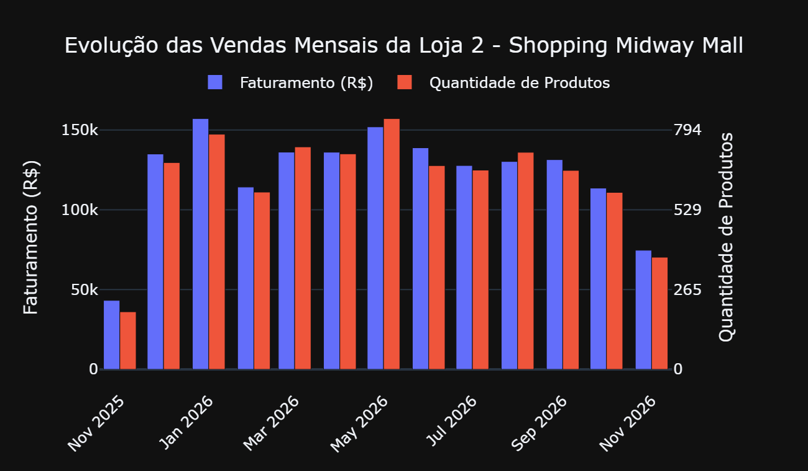
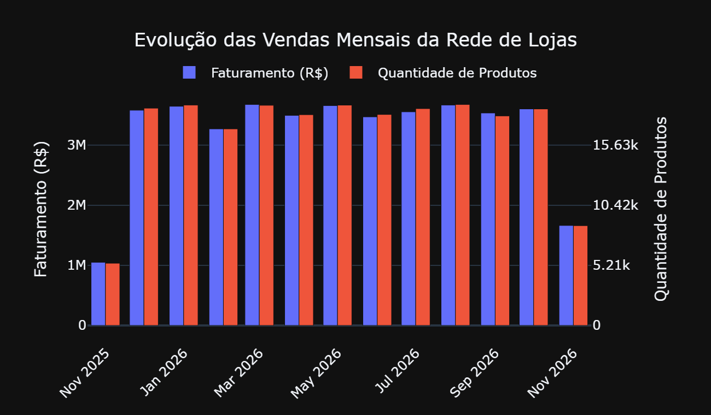
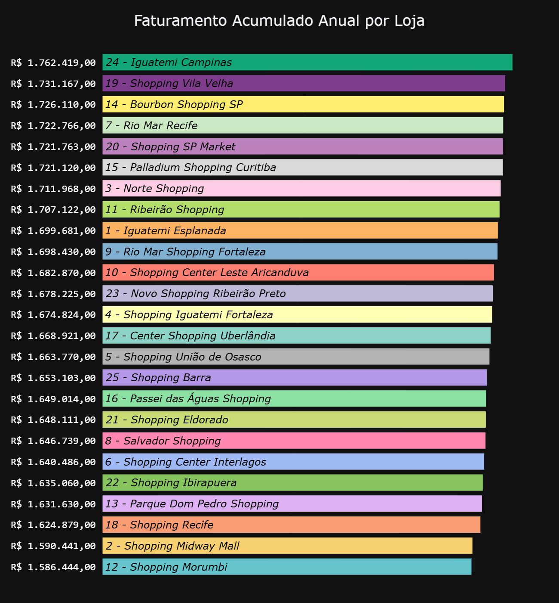

# Automação de Indicadores de Desempenho — Rede de Lojas (OnePage)

Rotina automatizada em Python para consolidação de vendas, apuração de metas, geração de gráficos estatísticos, simulação visual em PDF e envio diário de relatórios executivos (_OnePage_) por e-mail para gerentes de lojas e para a diretoria da rede.

🔗 **[Acesse a Documentação Técnica Online (GitHub Pages)](https://arnosf.github.io/automacao-indicadores-lojas/)**

---

## Destaques e Particularidades Técnicas

- **Configuração Híbrida (`config.toml` + CLI):** Permite definir comportamentos padrão de saída e diretórios em arquivo estruturado (`tomllib`), com possibilidade de sobrescrita dinâmica via flags de linha de comando (`argparse`) para rotinas agendadas.
- **Templates HTML com CSS _Inline_:** Utiliza **Jinja2** para composição dinâmica dos relatórios e **Premailer** para converter regras CSS em atributos _inline_, garantindo renderização fiel nos principais clientes de e-mail.
- **Gráficos Embutidos via CID (_Content-ID_):** Os gráficos gerados com **Plotly** são anexados ao payload MIME com identificadores únicos (`make_msgid`), evitando bloqueios de imagens externas pelos provedores de e-mail.
- **Simulação Fiel em PDF:** Converte o corpo HTML de cada e-mail em arquivo PDF utilizando **Playwright** (Chromium _headless_), incluindo ajuste automático de escala para página única nas lojas e renderização de um cartão visual representando o arquivo Excel anexado.
- **Indicadores Visuais a partir de Booleanos:** Converte regras lógicas de atingimento de metas em indicadores visuais intuitivos tanto no HTML (`🟢` / `🔴`) quanto nas abas formatadas do Excel (`⬤` estilizado via **OpenPyXL**).
- **Auditoria e Rastreabilidade por Logs:** Registra todo o fluxo de execução, alertas e falhas críticas em arquivos diários (`logs/<aaaa-mm-dd>-log.txt`) utilizando o módulo nativo `logging`, facilitando o monitoramento em execuções agendadas.

---

## Visão Geral do Processo

A rotina executa diariamente as seguintes etapas:

1. **Leitura e Higienização (ETL):** Carrega as bases brutas (`Vendas.xlsx`, `Metas.csv`, `Emails.xlsx` e `Lojas.csv`), converte valores monetários e ajusta dinamicamente a série histórica para considerar a janela móvel dos últimos 365 dias até o dia anterior (`D-1`).
2. **Planilhas Individuais por Loja:** Gera arquivos Excel (`.xlsx`) formatados para cada loja contendo as abas `Diário` (detalhamento de vendas) e `Mensal` (resumo consolidado por mês).
3. **Apuração de Indicadores e Metas:** Calcula faturamento, diversidade de produtos (SKUs distintos) e ticket médio — tanto do dia anterior quanto do acumulado anual — comparando o realizado com as metas de cada loja e da rede.
4. **Relatórios Visuais e Simulação em PDF:**
   - Renderiza templates HTML responsivos via **Jinja2** e **Premailer**.
   - Gera gráficos em alta definição com **Plotly** (evolução mensal de vendas/volume e ranking anual horizontal das lojas).
   - Converte cada mensagem em simulação PDF via **Playwright**.
5. **Disparo via SMTP e Auditoria:** Envia e-mails individuais para cada gerente (com a planilha da respectiva loja em anexo) e um e-mail consolidado com rankings para a diretoria, registrando cada etapa e eventual exceção no log diário da execução.

---

## Demonstração de Resultados (`samples/`)

A pasta `samples/` contém exemplos reais das saídas geradas automaticamente pelo sistema:

### Gráficos Estatísticos Gerados

|                          Evolução Mensal (Loja)                          |                          Evolução Mensal (Rede)                          |
| :-------------------------------------------------------------------------: | :-------------------------------------------------------------------------: |
|  |  |

**Ranking Acumulado Anual por Loja:**


### Simulações de E-mail (PDF) e Planilhas Anexadas (Excel)

- 📄 **Simulações em PDF:**
  - [Exemplo de E-mail OnePage — Gerência de Loja (PDF)](samples/pdfs/exemplo_onepage_loja.pdf)
  - [Exemplo de E-mail OnePage — Diretoria da Rede (PDF)](samples/pdfs/exemplo_onepage_diretoria.pdf)
- 📊 **Planilhas Excel Formatadas:**
  - [Exemplo de Planilha de Vendas — Loja (XLSX)](samples/planilhas/exemplo_vendas_loja.xlsx)
  - [Exemplo de Planilha de Rankings — Diretoria (XLSX)](samples/planilhas/exemplo_ranking_diretoria.xlsx)

---

## Estrutura do Projeto

```text
automacao-indicadores-lojas/
│
├── assets/                                  # Recursos estáticos do projeto
│   └── templates/                           # Modelos HTML de mensagens de e-mail
│       ├── template_email_diretoria.html    # Modelo de e-mail consolidado para a diretoria
│       └── template_email_lojas.html        # Modelo de e-mail individual para as lojas
│
├── data/                                    # Armazenamento de dados
│   ├── raw/                                 # Bases de dados originais (entrada)
│   │   ├── Emails.xlsx                      # Cadastro fictício de contatos (gerência e diretoria)
│   │   ├── Lojas.csv                        # Cadastro base com nomes e IDs das lojas
│   │   ├── Metas.csv                        # Parâmetros de metas diárias e anuais
│   │   └── Vendas.xlsx                      # Histórico bruto de vendas
│   └── processed/                           # Planilhas processadas geradas na execução (ignorado pelo Git)
│
├── docs/                                    # Documentação técnica estática gerada pelo pdoc (GitHub Pages)
│   ├── index.html                           # Página inicial de redirecionamento
│   ├── search.js                            # Motor de busca instantânea
│   ├── src.html                             # Visão geral do pacote src
│   └── src/                                 # Documentação detalhada de cada módulo
│       ├── configuracao.html                # Funções de ambiente, config.toml, logs e .env
│       ├── main.html                        # Fluxo principal e flags de execução via terminal
│       ├── mensageria.html                  # Conexão SMTP, formatação de anexos e disparos
│       ├── modelos.html                     # Estruturas de dados e tipagem estática
│       ├── processamento.html               # Tratamento de dados, planilhas Excel e metas
│       └── relatorios.html                  # Templates Jinja2, gráficos Plotly e PDFs Playwright
│
├── logs/                                    # Registros diários de auditoria da execução (ignorados pelo Git)
│
├── notebooks/                               # Versão exploratória e interativa do pipeline
│   └── automacao_indicadores_lojas.ipynb    # Jupyter Notebook completo
│
├── reports/                                 # Saídas locais de gráficos e PDFs gerados (ignoradas pelo Git)
│
├── samples/                                 # Exemplos ilustrativos das saídas geradas pelo sistema
│   ├── graficos/                            # Exemplos de gráficos gerados (.png)
│   │   ├── exemplo_vendas_anuais_lojas.png  # Ranking de faturamento anual por loja
│   │   ├── exemplo_vendas_mensais_loja.png  # Evolução mensal de vendas de uma loja
│   │   └── exemplo_vendas_mensais_rede.png  # Evolução mensal de vendas da rede
│   ├── pdfs/                                # Exemplos de simulações visuais dos e-mails (.pdf)
│   │   ├── exemplo_onepage_diretoria.pdf    # Simulação do e-mail enviado à diretoria
│   │   └── exemplo_onepage_loja.pdf         # Simulação do e-mail enviado a uma loja
│   └── planilhas/                           # Exemplos de relatórios Excel anexados (.xlsx)
│       ├── exemplo_ranking_diretoria.xlsx   # Planilha de rankings enviada à diretoria
│       └── exemplo_vendas_loja.xlsx         # Planilha de vendas diárias/mensais enviada à loja
│
├── src/                                     # Código-fonte modularizado para produção
│   ├── __init__.py                          # Inicializador do pacote Python
│   ├── configuracao.py                      # Gerenciamento de ambiente, config.toml, logs e .env
│   ├── main.py                              # Orquestrador geral da rotina
│   ├── mensageria.py                        # Conexão SMTP, formatação de anexos e envio de e-mails
│   ├── modelos.py                           # Estruturas de dados e tipagem estática
│   ├── processamento.py                     # Tratamento de dados, planilhas Excel e apuração de metas
│   └── relatorios.py                        # Geração de HTML, gráficos estatísticos e PDFs
│
├── .env.example                             # Modelo de variáveis de ambiente necessárias
├── .gitignore                               # Regras de arquivos e pastas ignorados pelo Git
├── config.toml                              # Parâmetros configuráveis de saída e diretórios
├── README.md                                # Apresentação e guia de uso do projeto
└── requirements.txt                         # Dependências e bibliotecas do projeto
```

---

## Pré-requisitos e Instalação

- **Python 3.11 ou superior** (obrigatório devido ao uso da biblioteca nativa `tomllib`).

1. **Clone o repositório e acesse a pasta do projeto:**

   ```bash
   git clone https://github.com/ArnoSF/automacao-indicadores-lojas.git
   cd automacao-indicadores-lojas
   ```
2. **Crie e ative um ambiente virtual:**

   ```bash
   python -m venv .venv
   # Windows:
   .venv\Scripts\activate
   # Linux/macOS:
   source .venv/bin/activate
   ```
3. **Instale as dependências Python e o navegador do Playwright:**

   ```bash
   pip install -r requirements.txt
   playwright install chromium
   ```

---

## Configuração

### 1. Variáveis de Ambiente (`.env`)

Copie o arquivo modelo `.env.example` para `.env` na raiz do projeto e preencha com as credenciais do servidor de e-mail:

```env
REMETENTE_EMAIL=seu_e-mail@empresa.com
REMETENTE_SENHA=sua_senha_ou_token_de_aplicativo
PORTA_SMTP=587
SERVIDOR_SMTP=seuprovedor_de_e-mail.com
DESTINATARIO_EMAIL_TESTE=e-mail_para_teste@empresa.com
REMETENTE_NOME=Nome do remetente
```

_(Nota: O campo `DESTINATARIO_EMAIL_TESTE` é utilizado automaticamente caso existam linhas sem endereço de e-mail preenchido na planilha `Emails.xlsx`)._

### 2. Parâmetros de Execução (`config.toml`)

Ajuste os sinalizadores padrão de saída e os caminhos de destino no arquivo `config.toml`:

```toml
[outputs]
exibir_prints_acompanhamento = true
manter_planilhas = true
exportar_graficos = true
gerar_pdfs_email = true

[caminhos]
saida_planilhas = "data/processed/backup_vendas_lojas/"
saida_pdfs = "reports/pdfs/"
saida_graficos = "reports/graficos/"
```

---

## Como Executar

### Via Terminal (Produção / Agendamento)

Execute o script principal diretamente pela linha de comando:

```bash
python src/main.py
```

Você pode sobrescrever temporariamente as opções do `config.toml` utilizando flags no terminal:

| Flag                               | Descrição                                                                   |
| :--------------------------------- | :---------------------------------------------------------------------------- |
| `-s`, `--silencioso`           | Oculta os prints de acompanhamento no console (ideal para tarefas agendadas). |
| `-m`, `--nao-manter-planilhas` | Remove as planilhas individuais das lojas do disco após o envio do e-mail.   |
| `-g`, `--sem-graficos`         | Não grava os arquivos `.png` dos gráficos na pasta `reports/graficos/`. |
| `-p`, `--sem-pdfs`             | Não gera os arquivos `.pdf` de simulação na pasta `reports/pdfs/`.     |

**Exemplo de execução silenciosa sem salvar PDFs locais:**

```bash
python src/main.py -s -p
```

> **Nota sobre o modo silencioso (`-s`):** Mesmo quando executado com a flag `-s`, a mensagem inicial de identificação do ambiente, eventuais falhas na leitura do `config.toml` e erros críticos (`CRITICAL`) continuam sendo exibidos no console para garantir visibilidade imediata de falhas operacionais. Todas as etapas continuam sendo gravadas normalmente no arquivo de log diário em `logs/<aaaa-mm-dd>-log.txt`.

### Via Jupyter Notebook

Abra o arquivo `notebooks/automacao_indicadores_lojas.ipynb` no VS Code ou Jupyter Lab e execute todas as células. O código identifica automaticamente o ambiente interativo e utiliza `ThreadPoolExecutor` para renderizar os PDFs sem conflitar com o loop assíncrono do notebook.

---

## Documentação Técnica

A referência completa das funções, assinaturas e estruturas de dados (`NamedTuple` e `TypedDict`) está publicada online via GitHub Pages e também armazenada localmente na pasta `docs/`.

- **Acesso Online:** [https://arnosf.github.io/automacao-indicadores-lojas/](https://arnosf.github.io/automacao-indicadores-lojas/)
- **Atualização Local (PowerShell):**
  ```powershell
  $env:PYTHONPATH="src"; pdoc ./src -o ./docs; Remove-Item Env:PYTHONPATH
  ```

---

## Tecnologias Utilizadas

- **Manipulação de Dados e Planilhas:** Pandas, OpenPyXL
- **Visualização de Dados:** Plotly, Kaleido
- **Templates e Estilização de E-mail:** Jinja2, Premailer
- **Geração de PDF:** Playwright (Chromium _headless_)
- **Configuração, Logs e Ambiente:** `tomllib`, `logging`, `python-dotenv`, `argparse`
